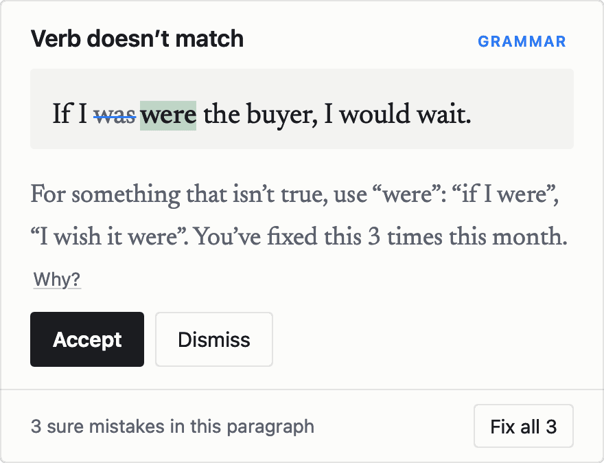
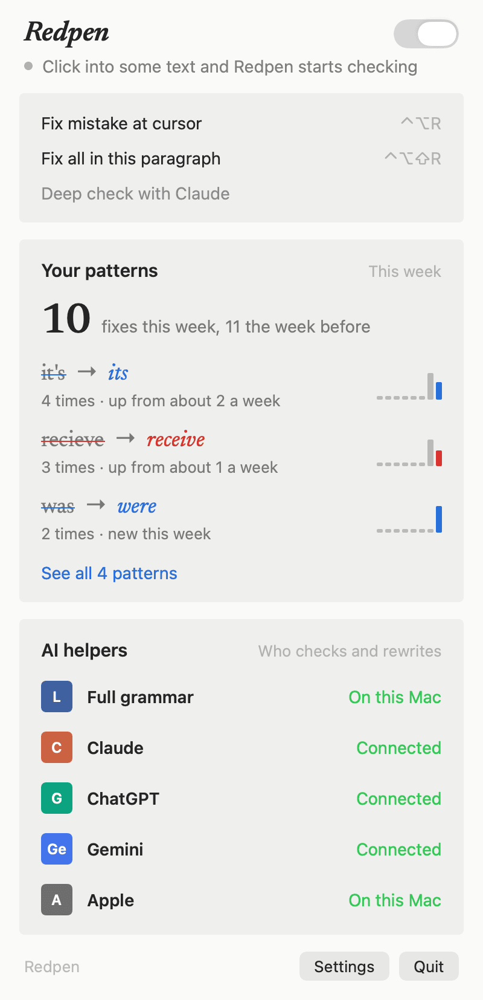
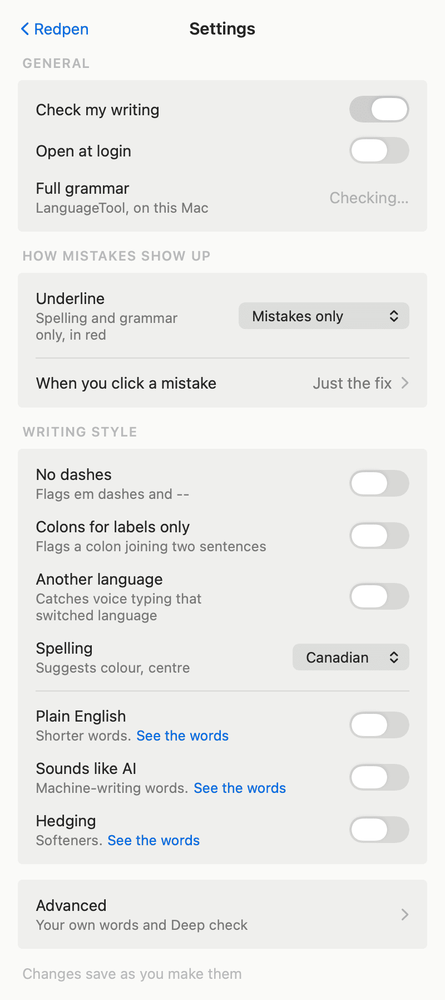
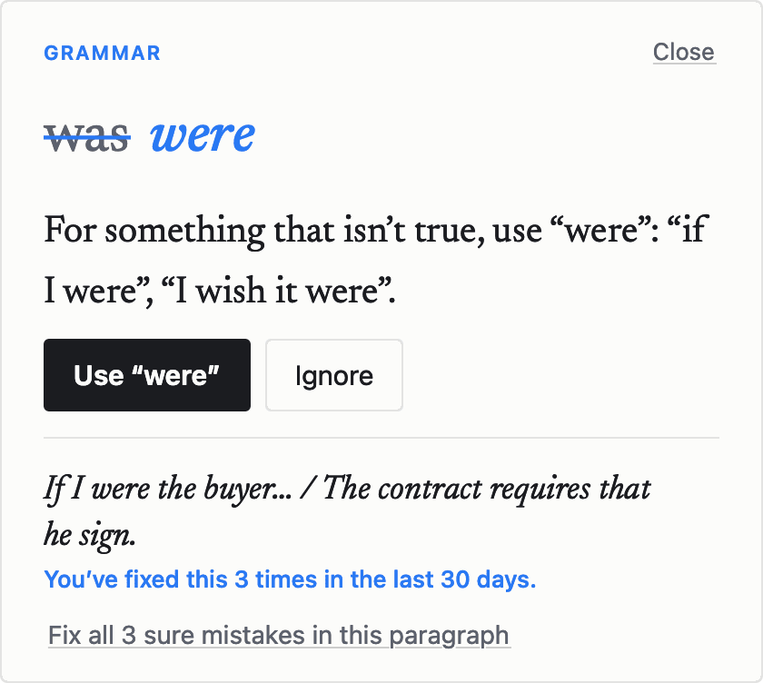
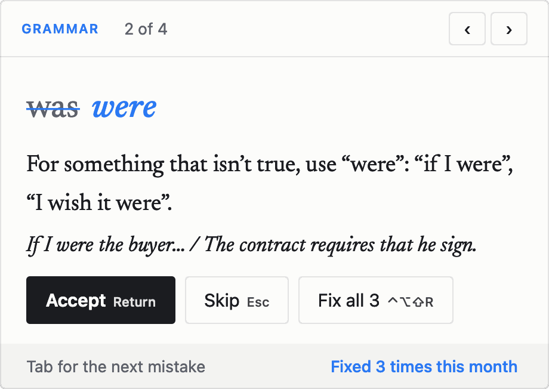

# Redpen Grammar for Mac

A free, private writing checker for macOS, from the Redpen family of writing tools. It underlines mistakes as you type in almost any app (Mail, Notes, Word, Chrome, Slack, even Terminal), and each fix explains the rule so you make the mistake less often.

Everything runs on your Mac. Your writing is never sent anywhere unless you choose **Deep check**.

<p align="center">
<picture>
  <source media="(prefers-color-scheme: dark)" srcset="docs/screenshots/fix-sentence-dark.png">
  
</picture>
</p>

## What it does

- **Red underline:** spelling. **Blue:** grammar. **Purple:** your own house-style rules (optional).
- **Click an underline** to see the fix, a one-line reason and an example. One click applies it.
- **Choose what you see when you click a mistake,** in Settings: **Just the fix** shows the fix large with its lesson, **The fix in my sentence** shows your whole sentence with the fix in place, and **One by one, with the keyboard** lets you work through a draft without the mouse: Return fixes, Esc skips, Tab goes to the next mistake.
- **Fix all:** when a paragraph has several mistakes, the card offers **Fix all**, or press Control-Option-Shift-R. Each word is fixed on its own, so bold and italics stay.
- **Calm by default:** Redpen underlines only sure spelling and grammar mistakes. Switch **Underline** to **Everything** in the menu to also see your style rules and Apple's "maybe" suggestions.
- **Spelling that reads the sentence:** with Apple Intelligence on, the first suggestion is the word the sentence needs. "I liked it, thougt it cost too much" offers *though*; "I thougt about it" offers *thought*. The choice is only ever one of the dictionary's own suggestions.
- **Your patterns** (in the menu) shows which mistakes keep coming back this week, and whether each is going up or down. The record stays on your Mac, holds only the flagged words and the fix, never your surrounding text, and keeps the last 90 days.
- **Terminal:** when you type a sentence (not a command) in Terminal, or another terminal that tells the Mac which pane has focus, a small bubble offers to fix it. Where a terminal doesn't say, Redpen stays quiet rather than risk fixing the wrong tab.
- **Deep check** (optional): sends the paragraph you're in to Claude, ChatGPT or Gemini through each one's official command-line tool and the plan you already have: [Claude Code](https://claude.com/claude-code) for Claude, [Codex](https://github.com/openai/codex) for ChatGPT, Google's [Antigravity CLI](https://antigravity.google/docs/cli/headless/) for Gemini. Pick one in **Settings**, under **Advanced**, with **Fast** or **Best**. It shows a revised version and a list of changes. When the text is an email that asks for something, it adds up to three notes on how to make it easier to answer. Switch the window to **Email** to have it rewritten as one: the ask up top, one ask, easy to say yes to. The ten email rules are in `Sources/RedpenCore/DeepPrompt.swift`, written in Redpen's own words from ideas in Joanna Wiebe's Copyhackers courses and Todd Rogers and Jessica Lasky-Fink's *Writing for Busy Readers*.

<p align="center">
<picture>
  <source media="(prefers-color-scheme: dark)" srcset="docs/screenshots/menu-dark.png">
  
</picture>
<picture>
  <source media="(prefers-color-scheme: dark)" srcset="docs/screenshots/settings-dark.png">
  
</picture>
</p>

Click a mistake and you choose, in Settings, what the fix box shows:

<table>
<tr>
<td valign="top"><picture><source media="(prefers-color-scheme: dark)" srcset="docs/screenshots/fix-card-dark.png"></picture><br><b>Just the fix</b><br>The mistake, the fix and a short lesson.</td>
<td valign="top"><picture><source media="(prefers-color-scheme: dark)" srcset="docs/screenshots/fix-sentence-dark.png"></picture><br><b>The fix in my sentence</b><br>Your whole sentence, with the fix in place.</td>
<td valign="top"><picture><source media="(prefers-color-scheme: dark)" srcset="docs/screenshots/fix-keyboard-dark.png"></picture><br><b>One by one, with the keyboard</b><br>Return fixes, Esc skips, Tab goes to the next mistake.</td>
</tr>
</table>

Redpen never reads password managers, password fields, or browser pages whose title names a bank, card company, broker or payment app (Canadian, US, UK and Australian names are built in, and you can add more in the settings file). Its log holds app names and counts, never your writing, and the log, your settings and your mistakes list can only be opened by your own Mac account. Text goes to the grammar engine only when the engine on your Mac belongs to your account. Deep check runs Claude Code with its tools, MCP servers, skills and hooks switched off, Codex read-only in an empty folder with its command, browser and plugin tools, web search and MCP servers switched off (it still reads your personal `~/.codex/AGENTS.md`; Codex has no way to skip it), and the Antigravity CLI in an empty folder inside its sandbox, which restricts terminal commands, with commands that need approval refused. Commands you have already allowed in your own Antigravity settings stay allowed within that sandbox; the Antigravity CLI has no way to switch them off. Hooks your organisation enforces through a managed policy can't be switched off by Redpen.

## How it checks

Three engines, all local, combined so each covers the others' blind spots:

1. **Apple's spell checker**, built into macOS.
2. **[LanguageTool](https://languagetool.org)**, the open-source grammar engine, running on your Mac (port 8081). A word only counts as misspelled when the Mac dictionary agrees, so names and trade words don't light up.
3. **Apple's on-device language model** (Apple Intelligence) for errors that need meaning: commonly confused words (compliment / complement, principle / principal), verb forms, missing words. The model checks one sentence at a time, and a second pass must confirm each change, which keeps it from rewriting good sentences.

## How good is it?

Redpen was tested three ways.

- **Does it catch mistakes?** We wrote 100 short sentences, each with one mistake: a misspelling, a grammar slip, a mixed-up word like *their* and *there*, or a broken style rule. Redpen caught 98.
- **Does it leave good writing alone?** On 35 sentences with nothing wrong, it flagged none.
- **Does it nag?** We ran it over 120 paragraphs of published writing that had already been edited, so almost anything flagged there is a false alarm. Redpen flagged 11. Grammarly's free version flagged 35 of the same paragraphs.

Fewer flags on finished writing means fewer interruptions while you work.

## Download

**[Download the latest Redpen Grammar](https://github.com/cjaynewton/redpen-grammar-mac/releases/latest)** (the `.dmg` file), open it, and drag Redpen Grammar into Applications. If you have an older copy called Redpen, delete it. It's signed and notarized by Apple, and needs **macOS 14 Sonoma or later** on a Mac with Apple silicon (M1 or newer). The Apple Intelligence checks need macOS 26. No Xcode or Homebrew is needed. The first time it opens, a welcome window walks you through the one permission macOS needs, then click **Turn on** next to **Full grammar** in the Redpen menu for the grammar engine.

## Build from source

You need **macOS 14 Sonoma or later** (macOS 26 for the Apple Intelligence checks), **Xcode** (free, from the Mac App Store; open it once after installing), and **[Homebrew](https://brew.sh)** for the grammar engine. **Apple Intelligence** turned on is recommended: without it Redpen still runs, minus the confused-word and meaning checks.

```sh
git clone https://github.com/cjaynewton/redpen-grammar-mac.git
cd redpen-grammar-mac
./install.sh
```

`install.sh` installs LanguageTool with Homebrew, starts it (and at every login), builds Redpen Grammar into `~/Applications`, and opens it. A welcome window walks you through the one permission macOS needs (**Accessibility**, so Redpen can read what you type).

No Homebrew? Run `./build.sh` instead, then click **Turn on** next to **Full grammar** in the Redpen menu. Redpen downloads LanguageTool and a Java runtime (about 300 MB) into `~/Library/Application Support/Redpen/engine` and runs it itself while Redpen is open. Until then, spelling and basic grammar still work.

### Rebuilding without re-granting permission

By default the app is ad-hoc signed, and macOS may ask you to allow Accessibility again after each rebuild. If you have an Apple Development certificate (free with an Apple ID in Xcode), create a `.local.env` file next to `build.sh`:

```sh
REDPEN_SIGN_ID="Apple Development"
```

## House style (optional)

House style is for rules that aren't grammar: a personal or team style guide. All of it is off until you turn it on in **Settings**, which opens from the Redpen menu. The everyday rules are on the main Settings page:

- No dashes (em dash, spaced en dash, `--`)
- Colons only for labels and lists, not to join two thoughts
- Flag sentences that came through in another language (handy with voice typing)
- Hold spelling to one English: Canadian (colour, centre), American or British
- Three starter sets to switch on: **Plain English** (*utilize* becomes *use*), **Sounds like AI** (*delve*, *tapestry*, *seamless*) and **Hedging** (*I think*, *sort of*)

Your own lists live under **Advanced**, at the bottom of Settings:

- Vague words to flag in long writing (for example *framework*, *ecosystem*, *leverage*)
- Phrases to cut (for example *to be clear,*)
- Notes for the Deep check editor

[`examples/house-style-example.json`](examples/house-style-example.json) has a full example. Settings live in `~/Library/Application Support/Redpen/config.json`.

## Development

Apple's model framework needs Xcode's toolchain, so point Swift at it first:

```sh
export DEVELOPER_DIR=/Applications/Xcode.app/Contents/Developer
./build.sh                     # build and install the app
swift run redpen-test          # built-in test sentences
swift run redpen-test --blind  # also --held-out, --blind2, --blind-file <tsv>, --patterns
```

To test Redpen on your own writing, put one finished paragraph per line in a file as `clean<TAB>paragraph<TAB>` and run `swift run redpen-test --blind-file yourfile.tsv`. Any flag on edited writing is likely a false alarm. The published-writing test above isn't included, because it uses someone's own articles.

Code layout:

- `Sources/RedpenCore`: the checking engine (rules, LanguageTool client, Apple model, lessons, mistake log). No UI.
- `Sources/Redpen`: the menu-bar app (Accessibility watcher, underline overlay, fix card, Terminal mode, settings).
- `Sources/redpen-test`: the test runner.

The test sets were written before tuning and the blind sets were scored once. If you change the engine, write new test sentences rather than tuning on the existing ones.

## Not affiliated

Redpen for Mac is an independent project. It is not related to [RedPen](https://redpen.cc), the open-source proofreading tool for technical documents, or to Grammarly.

## License

MIT. See [LICENSE](LICENSE). LanguageTool is a separate program under its own license (LGPL); Redpen talks to it over a local connection and does not include it. The **Turn on** button downloads it unchanged from languagetool.org, with the Eclipse Temurin Java runtime from adoptium.net.
